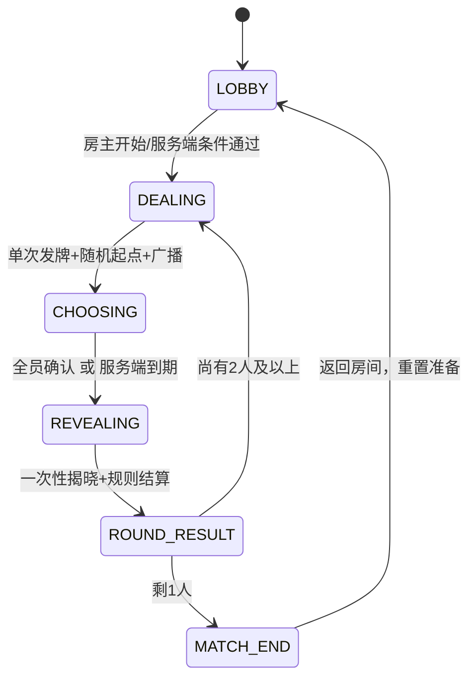

# 领域数据模型、回合状态与不变量

> **2026-11-18 优先说明**：最新方案要求 P2P。本文件后续出现的“服务端/服务器”属于过去集中式建议下的称呼；若选 Host-Client 则解释为玩家房主的逻辑权威，若选 Mesh 则需重设计状态同步与共识。详情见 [P2P RFC](03-p2p-architecture-options.md)。

> 状态：协议前的设计约束；字段名是建议名称，最终版本由实现评审锁定。  
> 主原则：身份稳定、轮盘位置可变、规则数据单一权威、未公开行动绝不进入公共快照。

## 1. 主要实体

### Room（房间，服务端内存）

| 字段 | 类型语义 | 说明 |
| --- | --- | --- |
| `room_id` | 内部唯一 ID | 不直接等同于可见房间码 |
| `room_code` | 人类可输入短码 | 唯一、避免重复，创建失败可重试 |
| `host_player_id` | 玩家 ID | 仅房间操作权限；并非 server 网络权限 |
| `members` | 所有未离开房间的玩家 | 包括游戏中已经出局但仍观看的人 |
| `lobby_status` | LOBBY / IN_MATCH | 禁止对局中途加入 |
| `match` | 可空 | 本局权威 GameState |
| `version` | 递增版本号 | 用于过滤过时状态 |

### Player / Membership

- `player_id`：本局生命周期内稳定的唯一 ID。
- `peer_id`：当前 Godot 连接的网络 ID，由服务器绑定，不由客户端选择。
- `display_name`：a、b、c……（加入时分配，整局稳定）。
- `is_connected`、`is_ready`、`is_alive`；是否为本地的「你」由客户端按 peer 映射确定。
- `wheel_index`：仅在当前回合状态中存在，不能替代 `player_id`。
- 断线不能让新连接直接冒充旧 `player_id`；首版没有自动重连。

### Card

- `card_id`：一局唯一字符串或递增整数。
- `value`：发牌时 `1..n` 的数字，后续永不改动。
- `owner_player_id`：原持有者，不因打牌或淘汰改写。
- `status`：HELD / PLAYED / ELIMINATED。
- `issued_round_id`、`consumed_round_id?` 可供统计与审计。
- 服务器不持有「剩余牌堆」，每次独立生成新牌。

### Match / Round

- `match_id`：每次开始新局生成新的标识，用于拒绝上局迟到消息。
- `round_id`：单调递增，从 1 开始；不因重试重复。
- `alive_order`：按轮盘顺时针顺序存放稳定的 `player_id`。
- `phase`：LOBBY（不在 Match 内）、DEALING、CHOOSING、REVEALING、ROUND_RESULT、MATCH_END。
- `initial_target_player_id` / `initial_target_index`，`cards_by_player`。
- `pending_actions`：服务端内部映射 `player_id -> final_action`；**从不出现在其他人的 CHOOSING 快照中**。
- `deadline_ticks_ms`：服务端单调时间；客户端只接收剩余时间的近似显示信息。
- `state_version`：每次对外可见权威状态改变递增。

## 2. 统一的行动类型

```text
Action {
  type: "pass" | "play",
  card_id: <仅 type=play 时>,
  sign: +1 | -1 <仅 type=play 时>
}
```

行动**不接受客户端传来的 player_id、room_id 作为身份凭据**。服务端从 RPC 源 peer 查所属房间和玩家，再检查当前 `match_id/round_id`；客户端带的 ID 只用于匹配请求上下文，不能授予身份。

## 3. 权威回合状态机



- `REVEALING` 可以是瞬时权威阶段；展示动画在客户端继续，**不得在客户端重入规则结算**。
- `ROUND_RESULT` 保证所有人有机会看到淘汰事件；下一轮自动推进的时刻由服务器控制。
- 本轮 `CHOOSING` 到期/全员确认只允许触发一次 `finalize_round`，任何后来的计时回调与重复 RPC 必须无效果。
- 任意阶段未达 2 人不能错误进入 DEALING。
- 开始新局前清理上局出牌、牌 ID 计数器（允许新 match 重新计数但 `match_id` 不可重复）、已出牌统计和临时展示状态。

## 4. 不变量（每次状态迁移之后都可自动检查）

1. `2 <= initial_player_count <= 12`；进行中 `1 <= alive_order.size <= initial_player_count`。
2. `alive_order` 中玩家 ID 不重复，成员身份存在，当前轮次 wheel index 是 `0..n-1` 的连续序列。
3. 每名存活者每轮恰好新增 1 张牌；淘汰者不再获得牌。
4. 每张 `card_id` 唯一、仅有一个 owner 和一个状态；每个已确认的 PLAY 只能消耗本人的一张 HELD 牌。
5. 本轮最多一个已确认行动/玩家；在 CHOOSING 之外没有新的可接受动作。
6. 公共快照在 REVEALING 前不包含 `pending_actions`、对手的 `card_id + sign` 选择、服务端内部随机状态。
7. `issued = played + eliminated + held`（结算完成后，按每个值与总量）。
8. 所有客户端在相同的 `match_id + round_id + state_version` 下，对应相同权威公共状态。
9. 正常完成一轮后 `n` 恰好减少 1；`n=1` 后不会继续发牌。

## 5. 数据存储与恢复策略

- 首版全部房间状态保存在服务端**内存**中，不接数据库。
- 客户端按事件推进视图，接入房间后通过一次**完整公开快照**初始化，出现版本跳跃时请求刷新。
- 无服务器崩溃后续局功能；服务器重启后旧房间不可恢复，应给用户错误提示。
- 不把游戏的规则状态存在 `user://`；如未来有音量等偏好设置，再使用 Godot 内置 `ConfigFile`/`user://`。

## 6. 本地代码类型与网络序列化边界

- 规则内部可使用易测试的数据类/字典；进入 RPC 时转换为 Godot 支持的简单可序列化类型（Dictionary、Array、int、String、bool 等）。
- 网络数据只暴露必要字段，客户端不直接接收 `Room` 或 `Match` 实体对象的引用/整个私有状态。
- 一切兼容/字段更改同步更新 [协议设计](../03-network/01-protocol.md) 和 [测试](../05-engineering/02-testing.md)。


## 7. 核验补充：状态公开边界与规模上界

### 私有状态和公共状态必须使用不同数据结构

- 内部 GameState 允许包含 pending_actions、完整 peer 映射、房间管理索引、服务端 RNG 状态与截止时钟；公共 RoundSnapshot 必须按明确白名单构建，**不能先序列化全量 GameState 再“隐藏”字段**。
- public_snapshot 在 CHOOSING 期允许披露公开手牌、初始目标、轮次、确认数量与允许显示的状态，不包含其他玩家 PASS/出牌/正负方向。自己的回执私发。
- 对外事件都附带 match_id、round_id、state_version；客户端版本缺口通过仅包含公共字段的快照恢复。过期事件只读丢弃，不能自行演算权威结果。
- 在服务器同时存在两个房间时，任何业务操作必须先通过发送者 peer_id 查到当前 room_id 与稳定 player_id，然后才允许访问该房间数据。
- 即使服务端对业务事件做了房间隔离，也必须关闭 SceneMultiplayer 默认 server_relay 的其他 peer 通知/转发能力（实施前做实际验证）。

### 数量上界（用于 UI 与网络压测）

若初始 N 人，每轮恰好淘汰 1 人，从 N 到 2 共 N-1 个行动回合，最多发牌总数：

**issued_max(N) = N + (N-1) + ... + 2 = N(N+1)/2 - 1**。

- N=12：最多 11 轮、77 张累计发牌；单名玩家最多 11 张累积未打手牌。
- N=8：最多 7 轮、35 张累计发牌；单名玩家最多 7 张累积未打手牌。
- 这是逻辑数据容量上界，**不代表 12 人 UI 在小窗口里一定可读**；渲染须另行测量。

### 随机性分层

- 牌值、初始指向使用服务器独占 RandomNumberGenerator；测试时可注入固定 seed，绝不把服务器状态或未来随机结果广播。
- 房间码不建议使用可预测的游戏内 PRNG，应使用 Godot Crypto.generate_random_bytes() 作为短码源；服务端仍做撞码检验、尝试次数限制与资源限额。
- Godot RNG 可提供基础伪随机均匀抽样，但当前设计**没有承诺可公开审计的公平性协议**；若新增该要求，需另立需求。

参考：[Godot 4.7 Randomness](https://docs.godotengine.org/en/4.7/tutorials/math/random_number_generation.html)、[Crypto](https://docs.godotengine.org/en/4.7/classes/class_crypto.html)、[可行性审计](../05-engineering/04-feasibility-audit.md)。

## 8. 2026-11-18 已确认的状态机时限与房间语义

- 房间开始守卫：`member_count >= 2`、`member_count <= 12`、所有在场成员已准备、发起人为当前房主，且房间处于 LOBBY；由服务端/权威实体复验（D-04）。
- **D-05：** 进入 CHOOSING 时设唯一的 15 秒权威截止时间；所有存活者动作有效锁定可提前进入 REVEALING。倒计时显示、网络传输延迟和客户端动画均不能延长截止。
- **D-06：** 在 LOBBY 退出移除席位；比赛中断开连接不改变 is_alive，仅标记 is_connected=false；已有合法锁定动作保持，未锁定动作自动 PASS，以后轮次仍按 PASS，直到正常淘汰；不在此版引入重连恢复。
- **D-07：** 产生胜者后转回房间，所有成员需要重新准备；下一局使用新的 match_id 并重置牌、统计、行动锁定状态，进行中禁止新玩家加入。
- **D-08：** 人机 P1；领域模型不应为未来 Bot 复制一套结算规则。
- **D-03：** 本文状态约束独立于 ENet 或 WebSocket 具体传输选型；“服务端权威”属于原文 P0，具体架构仍待讨论。

## 9. P2P 领域状态归属与一致性补充

> 原文件部分“服务端内存/服务器分配 peer_id/服务端截止时钟”的措辞沿用旧集中式推荐；这些只适用于**房主型 P2P 候选中，由房主执行逻辑服务器职责**的情况，**不等于已经选定 Host 模式**。

- Host-Client 候选：房主本机持有可变对局状态，普通参与者只读公共快照；但房主可看到提交到它那里的明文秘密动作，需 D-03d 重新审议保密。
- Full Mesh 候选：所有人维护公共状态，但必须新增随机数一致性、事件顺序、15 秒截止时间、承诺/揭晓、丢包、分歧与掉线处理；简单复制数据结构不能保证对局一致。
- room_code 不等同 peer_id；如果选择平台 Lobby 或轻量信令，它还需要由发现层映射到实际网络会话。
- 一般成员掉线按 D-06 处理；房主/协调者失联与状态迁移是独立的 D-03f。
- 卡牌 ID、玩家 ID、统计守恒及 2～12 人上限是与网络拓扑无关的已确认规则。

参见 [P2P 详细架构](03-p2p-architecture-options.md) 与 [决策清单](../00-product/02-open-decisions.md)。

## 10. 2026-11-18 Commit–Reveal 的领域状态补充

D-05 的 15 秒正式确定为 COMMIT_OPEN 决策期，之后允许独立的 FREEZE / REVEAL_OPEN / VERIFY 阶段（具体超时仍待批准）。不改变正常回合一次淘汰一名玩家的规则。

- **玩家本地私密**：draft_action、nonce、sealed_action、自己是否收到 COMMIT_ACK；未揭晓前绝不能对 Host 公布行动明文。
- **共同公开**：commit_hash、已确认数量、冻结 manifest_hash、玩家正常/自动 PASS 状态；REVEAL 时再公开 action + nonce。commit_hash 不应包含没有随机盐的可猜测明文编码。
- **Host 候选状态**：以 room/match/round 归属保存承诺列表，已锁定不能替换；FREEZE 后不可重写。是否对 manifest 使用签名/见证待 D-03k。
- **需要明确区分**：NOT_COMMITTED、COMMITTED、AUTO_PASS、REVEALED_VALID、REVEAL_MISSING、REVEAL_INVALID。不能把 COMMITTED 自动等于已经验证的 PLAY。
- **D-06 新冲突**：COMMITTED 但 REVEAL_MISSING 时，无法从 hash 恢复具体牌与加减；旧版“已确认合法行动必须保留”无法由纯 hash 直接满足。未决方案为 D-03j 的 N1/N2/N3。
- 对局只在达成一致的最终有效动作集合后消耗牌并更新统计。异常状态不可以让各客户端分别结算不同赢家。

详见 [Commit–Reveal RFC](../03-network/04-commit-reveal-rfc.md)。

## 11. 初始生命字段与结算事件（2026-11-18）

- Room/Lobby 新增 `initial_lives: int`，当前 Demo 允许 Host 在 **1～5** 调整，默认 1，比赛开始后锁定。
- Match 新增 `lives: Dictionary[player_id -> remaining_lives]`，从初始生命统一初始化；`public_state` 向所有玩家广播当前生命和初始生命。
- 每轮返回 `hit_peer`、`remaining_lives` 和 `eliminated`：**eliminated=0 表示此次命中未淘汰玩家**，而非索引 0；归零时才对真实 player_id 淘汰并弃置余牌。
- 必须保持 `1 <= hp <= initial_lives` 对当前存活者成立；已淘汰者生命为 0，不在 alive_order。**本轮仅保证命中一人，不能再使用“每轮必淘汰一人”作为不变量。**
- 规则数字发牌范围仍根据**当前存活人数**而不是初始房间人数。详见 [规则规范](../01-gameplay/03-initial-lives.md)。
