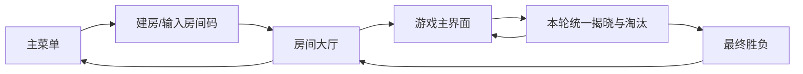

# 客户端场景、轮盘、手牌与交互规格

> **2026-11-18**：最新联网方向已变为 P2P，房主可兼任逻辑协调者，但尚未决定 Host-Client 或 Mesh；“创建房间”不默认连接固定公网专用服务器。短码发现与 Host 掉线处理仍待技术决策。

> 状态：设计提案；不代表已经创建 UI 场景。沿用原始需求 UI-01～UI-07。  
> 原则：少解释文字，但重要信息（连接、按钮、倒计时、结果）必须清晰。

## 1. 页面与导航

### 主菜单

- 游戏 Logo、创建房间、加入房间、连接设置/错误提示、退出。
- 加房输入合法性：空码、格式错误、未找到、已满、已开局都应有可读提示。
- 与服务器断开后仍能正常回主菜单，不显示「已经创建成功」等虚假状态。

### 房间大厅

- 房间码（可复制）、当前成员列表、准备状态、房主标识。
- 本人显示「你」；所有玩家显示稳定名字 a、b、c……；不能因从客户端 A/B 打开就都把 0 号视为自己。
- **D-04 已确认：** 满足**至少 2 人、全员准备、发起者房主**时才能成功开始。按钮的可用状态由服务端规则决定，客户端可以做预校验，但不能替代服务端鉴权。
- 开局前有人离开更新列表和房主；对局结束后全员回房间且必须重新准备。

### 对局主界面

- 轮盘主体 + 每个存活者名字、方形明牌框。
- 上方/侧方简明显示：轮次、存活数、本轮初始指向、**15 秒决策倒计时**、已确认 X/Y、连接状态。本地倒计时只作提示。
- 本人的可选手牌列表、`+` / `-` 操作、不出牌、确认。
- 只读统计面板：每个数字和总量的已发/已出/淘汰弃/剩余；不能因隐藏而改变服务端数据。
- 已出局本人进入观察模式；可见本局公开信息但无法再操作。

### 统一揭晓和胜负

- **REVEALING**：确认锁定后不立即告诉他人行动，只显示锁定状态；揭晓事件一次展示所有人的 PASS/牌/方向。
- **ROUND_RESULT**：显示合计位移、轮盘最终落点、出局者；本轮打出的牌在 UI 上可标「已出」，下一轮移除。
- **MATCH_END**：显示最终幸存者和返回房间入口；返回后重新准备再开新局。

## 2. 轮盘版式（必须遵守原始约束）

| 元素 | 方案 |
| --- | --- |
| 扇区 | 按当前幸存者顺时针均分成 `n` 扇区，n=2～12 |
| 内容 | 扇区显示**玩家姓名**与对应的**方形牌框** |
| 指针 | 清晰区分随机初始指向与结算最终指向 |
| 中心 | **保持空白**，不增加中央说明文字或扇区编号 |
| 名字 | a、b、c……稳定；淘汰后位置重编但名字不换 |
| 淘汰反馈 | 最终扇区突出显示，玩家出局后下轮缩盘 |
| 卡牌 UI | 已出的牌可暂留本轮动画并标「已出」，不计为剩余 |

建议用 Godot 原生 `Control/CanvasItem._draw()` 画扇区和指针；方形牌框、文字和按钮采用 `Control` 派生节点和 `Container` 布局。不要为一个静态轮盘引入重量级第三方 UI 框架。

## 3. 自己的输入流程

1. CHOOSING 初始状态为「尚未选择」；提供显式「不出牌」选项。
2. 点击自己的任一仍持有牌，将其设为**本地草稿**；选择 `+` 或 `-`。
3. 玩家可反复改草稿；若选择 PASS，则清除被选牌和方向。
4. 点击「确认」后等待服务端回执；成功后显示「已确认/本轮锁定」，立即禁用牌、方向和再次确认。
5. 失败回执（例如回合已过期或牌状态更新）显示原因并刷新公共快照；**不能本地认定成功**。
6. 未确认的存活玩家在时限结束由服务端按 PASS；客户端 UI 仅反映服务端阶段变化。
7. 已出局玩家直接进入只读观察状态，控件不能被误操作。
8. **D-06 已确认：** 掉线者比赛席位保留，未确认行动和后续回合自动 PASS；不能立即显示因掉线淘汰。

## 4. 决策信息与隐私边界

- 公布的信息：所有人当前**持有**的明牌、位置、初始目标、剩余时间、已确认数量、公开后行动和结算。
- 未公开的信息：其他玩家选了哪张、加还是减、是不是 PASS；决策中只有本地本人能看自己的草稿与服务端本人确认回执。
- 不通过颜色、动画或状态提示暗示他人实际行动内容。建议仅统一显示「确认数量」而不暴露「谁确认了出牌」。
- 可选的「个人位移预览」必须标明是**忽略其他人行动的假设预览**，不是最终淘汰预测；该功能未经审批不作为 P0。

## 5. 适应布局与可读性

重点验收尺寸：
- **1440×960** 主设计尺寸。
- **1180×820** 缩小窗口，主要按钮和关键状态不可被遮挡。

人数：**2、8、12 人**；另外必须测试多轮囤牌、同数字多张的密集手牌。

优先使用 `MarginContainer`、`VBoxContainer`、`HBoxContainer`、`GridContainer`、`PanelContainer`、`ScrollContainer` 处理 UI；容器内不要堆固定像素布局。轮盘按可用区域等比缩放，玩家姓名和方形牌框不能无限缩小到无法辨认。

当 12 人或囤牌很严重时，可以提出「扇区显示关键卡牌 + 可展开完整手牌列表」作为 UI 改进方案，但其实施前需明确：
- 完整公开手牌必须容易查看；
- 选牌只允许操作本人持有的牌；
- 不能因为布局溢出将可用按钮甩出屏幕；
- 不能靠隐藏对手明牌来解决拥挤（违背公开信息规则）。

## 6. 状态反馈规范

| 情况 | 用户看到 |
| --- | --- |
| 连接中 | 正在连接及可返回入口 |
| 无法连接 | 错误原因和重试 |
| 大厅未准备 | 本人准备按钮及其他玩家的公开准备状态 |
| 决策中 | 可编辑操作区、剩余时间、已确认 X/Y |
| 本人已锁定 | 操作区禁用，清晰显示已确认 |
| 全员已确认 | 等待服务器统一揭晓，不单独预演结果 |
| 揭晓与淘汰 | 每人公开行动、合计位移、出局玩家 |
| 本人已淘汰 | 观察模式，可看到对局继续 |
| 游戏结束 | 一致胜者，返回房间及重新准备 |
| 服务器断开 | 不再允许提交，提示回主菜单 |

## 7. 首轮 UI 验收方式

按 [测试文档](../05-engineering/02-testing.md) 进行：2/8/12 人、1440×960 与 1180×820、窗口缩放、长手牌、所有人不出牌、个人被淘汰后观看、多端姓名一致、网络错误提示。只展示静态截图不算通过，须现场操作。

## 8. 网页调研补充：原生 UI 可实现性与排版约束

### 扇区与牌框实现分工

- `CanvasItem._draw()` / `draw_colored_polygon()` 等原生 2D 绘制用于轮盘扇区、边界和指向标记；`queue_redraw()` 只在轮盘状态变化时重绘。
- 玩家名、牌框与交互采用标准 `Control` 子节点，点击、悬停和焦点仍由 Godot 处理；不要把所有文字与按钮烘成单张图片。
- 外围信息与手牌面板使用 `MarginContainer`、`GridContainer`、`ScrollContainer` 等，先利用容器最小尺寸与大小标志排版，不能靠在屏幕外放一堆绝对坐标修复溢出。
- 公开/淘汰演出选用 `Tween` / `AnimationPlayer`；动画与服务端逻辑进度解耦，客户端不能因为跳过动画改变胜负。

### 人数与手牌数量边界

**仅初始生命为 1 时**，从 N 人到 1 人恰有 N-1 个行动回合，累计发牌最多 `N(N+1)/2-1`；12 人为 11 轮、77 张。**初始生命可设置为 2～5 后，这些不再是通用上界**；12 人、5 生命的理论回合上界为 59，需额外验收多轮囤牌布局。详见 [初始生命规范](../01-gameplay/03-initial-lives.md)。

需要专门测试 12 个窄扇区、玩家名字、方形牌框和多轮囤牌是否在 1180×820 可读。**完整公开信息不能被隐藏，只能合理分层展示**：轮盘扇区显示概览，侧边/浮层提供全部玩家按 player_id 对应的完整明牌列表；这一视觉降级方案必须先由团队批准，不能静默取代“玩家头顶明牌”。

### UI 可执行性测试（尚未执行）

1. Godot 4.7 下 2/8/12 人轮盘逐档尺寸测试，1440×960、1180×820 窗口缩放；无按钮/名称甩出窗口。
2. 生命=1 的多轮囤牌以及生命>1 的更长对局分别测试；牌框/完整明牌列表需要保持可读，牌 ID 与数值映射无误。
3. 本人锁定和超时后控件自动只读；被淘汰后可观看但不能出牌。
4. 网络断开/服务器不可达时状态可见且能返回菜单；不假装操作提交成功。

来源：[CanvasItem](https://docs.godotengine.org/en/4.7/classes/class_canvasitem.html)、[Control](https://docs.godotengine.org/en/4.7/classes/class_control.html)、[可行性审计](../05-engineering/04-feasibility-audit.md)。

## 9. 2026-11-18 UI 决策确认

- 房主建房与房间码入房；至少 2 人、全员准备后由房主开始（D-04）。
- 决策阶段显示 **15 秒**倒计时；所有存活玩家已完成确认（含掉线自动 PASS）可提前揭晓；客户端不自行决定截止（D-05）。
- 对局中掉线但未淘汰者不应在 UI 上被强制判输（D-06）。
- 游戏结束回原房间、所有人重新准备；对局中途拒绝新玩家入场（D-07）。
- 人机添加界面 P1，不作为首版验收前置（D-08）。
- 联网实现尚待 D-03 讨论，不应直接把界面操作代码绑定到某一种底层网络传输。

## 10. 2026-11-18 P2P 玩家操作体验补充

- “创建房间”由玩家发起，不默认向常驻专用游戏服务器注册。若选择 Host-Client 模式，该玩家会成为本局 Host；若选择 Mesh，则需先明确协调者的作用。
- D-04 的短房间码已被确认，但具体**如何映射为可连接的 Host/会话**要由 D-03b/c/g 选型。不能只画一个输码按钮就认为联网可实现。
- 如果网络不能直连或平台信令失败，界面要明确显示连接失败/重试，不显示虚假的“已加入”。
- 普通玩家掉线仍遵守 D-06 自动 PASS；**Host 掉线**可能需要整局中断或迁移，当前必须留为 D-03f 未决，不能以 UI 假装自动修复。
- 15 秒、全员提前确认、轮盘中央空白、扇区名字与方形明牌框、2/8/12 人布局及所有公开信息展示要求保持不变。
- 若采用 Hash Commit → Reveal，界面可能出现“已提交承诺 / 揭晓验证”两个阶段；具体时限与提示在获得批准后再设计。

详见 [P2P RFC](../02-architecture/03-p2p-architecture-options.md) 与 [P2P 连接方案](../03-network/03-p2p-connectivity-options.md)。

## 11. 初始生命可调的 UI 实现（2026-11-18）

- 大厅使用 **Godot 原生 SpinBox**：整数 **1～5**、默认 1，Host 可修改，其他玩家只读，设置通过已有 `lobby` 消息同步；**比赛开始后锁定**。
- 轮盘扇区在玩家名字旁显示 **HP 数值占位**，右侧完整明牌列表也同步显示 `当前生命/初始生命`，无外部美术资源或新的 Host 管理界面。
- 本轮命中但未淘汰时，应显示“命中 X，剩余生命 Y”，**不缩盘、不弃置仍持有手牌**；生命归零则显示淘汰并正常缩盘。
- 2/8/12 人、1～5 生命下对长牌列的布局可读性需要继续人工验收；当前只检查了小人数占位 UI。详见 [生命设置规则](../01-gameplay/03-initial-lives.md)。
